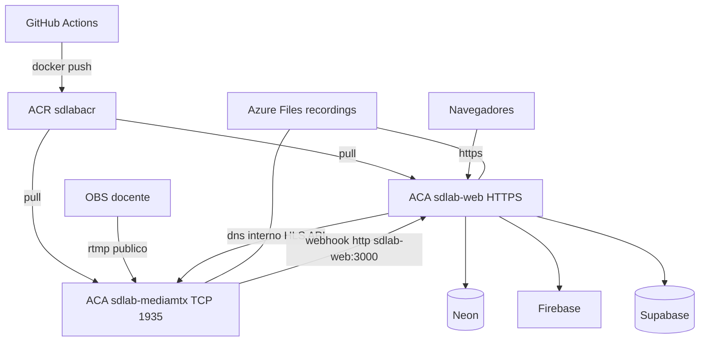

# Deploy exclusivo en Azure Container Apps + CI/CD GitHub

## Decisión fijada

**Producción = solo Azure Container Apps.** No VM, no AKS, no App Service.

- Environment compartido: `sdlab-env`
- Dos Container Apps: `sdlab-web` (Next.js, HTTPS) y `sdlab-mediamtx` (RTMP TCP 1935 + HLS/API internos)
- Imágenes en ACR `sdlabacr`
- Grabaciones en Azure Files montado en `/recordings`
- CI/CD: push a `main` → build → ACR → `az containerapp update`
- [`docker-compose.yml`](docker-compose.yml) y [`mediamtx.yml`](mediamtx.yml) se mantienen **solo para lab local**

Nombres por defecto: resource group `rg-sdlab`, región `westus2`, ACR `sdlabacr`, environment `sdlab-env`, apps `sdlab-web` / `sdlab-mediamtx`.

## 1. Cambios en el repo

### Imagen MediaMTX para Container Apps
- Añadir [`Dockerfile.mediamtx`](Dockerfile.mediamtx) desde `bluenviron/mediamtx:1.11.3` con config embebida (y herramienta HTTP para webhooks si hace falta).
- Añadir [`mediamtx.azure.yml`](mediamtx.azure.yml):
  - Webhooks a `http://sdlab-web:3000/api/webhooks/mediamtx` (DNS interno del Environment ACA).
  - `recordPath: /recordings/%path/...` (Azure Files).
  - HLS `mpegts` como en local ([`mediamtx.yml`](mediamtx.yml)).
- No usar `host.docker.internal` en ningún archivo Azure.

### Variables
- Actualizar [`.env.example`](.env.example) con bloque Azure Container Apps:
  - `RTMP_PUBLIC_URL=rtmp://<fqdn-tcp-mediamtx>:1935` (ingress TCP externo de `sdlab-mediamtx`)
  - `HLS_PUBLIC_URL=http://sdlab-mediamtx:8888` (solo red interna ACA; lo usa el proxy Next)
  - `MEDIAMTX_API_URL=http://sdlab-mediamtx:9997`
  - `MEDIAMTX_RECORDINGS_DIR=/recordings`
  - Sin depender de `OBS_URL` en cloud (estado = API/webhook MediaMTX)
- La app ya genera claves con `RTMP_PUBLIC_URL` ([`lib/mediamtx.ts`](lib/mediamtx.ts)) y reproduce vía `/api/hls/...` ([`app/api/hls/[...path]/route.ts`](app/api/hls/[...path]/route.ts)).

### Documentación + bootstrap
- Añadir [`docs/azure-container-apps.md`](docs/azure-container-apps.md) con pasos CLI.
- Añadir [`scripts/azure-bootstrap.sh`](scripts/azure-bootstrap.sh) que crea RG, ACR, Environment, Storage/Files, y las dos Container Apps (ingress HTTP + TCP).

## 2. Infra Azure Container Apps (bootstrap una vez)

1. Resource group + ACR (pull con managed identity de las Container Apps).
2. Log Analytics + **Container Apps Environment** `sdlab-env`.
3. Storage Account + Azure Files share `recordings`; volume mount `/recordings` en ambas apps (mtx RW, web RO).
4. **Container App `sdlab-mediamtx`**
   - Imagen `sdlabacr.azurecr.io/sdlab-mediamtx:latest`
   - Ingress: **TCP externo 1935** (OBS)
   - Target ports internos: 8888 (HLS), 9997 (API) sin exposición pública
   - minReplicas 1, ~1 vCPU / 2 Gi
5. **Container App `sdlab-web`**
   - Imagen `sdlabacr.azurecr.io/sdlab-web:<sha>`
   - Ingress: **HTTPS externo** → contenedor puerto 3000
   - Secrets/env de runtime: `DATABASE_URL`, Firebase Admin, Supabase, UploadThing, `RTMP_PUBLIC_URL`, `HLS_PUBLIC_URL`, `MEDIAMTX_API_URL`, `MEDIAMTX_RECORDINGS_DIR`
   - `NEXT_PUBLIC_*` inyectados en **build** de la imagen (Dockerfile ARGs)
6. Tras crear mtx, copiar el FQDN TCP público a `RTMP_PUBLIC_URL` del secret de `sdlab-web`.

## 3. CI/CD GitHub Actions → Container Apps

Crear [`.github/workflows/deploy-azure.yml`](.github/workflows/deploy-azure.yml):

- Trigger: `push` a `main` + `workflow_dispatch`
- Pasos:
  1. Checkout
  2. Login ACR
  3. `docker build` web (build-args `NEXT_PUBLIC_*` desde GitHub Variables/Secrets)
  4. Push `sdlab-web:$GITHUB_SHA` y `:latest`
  5. Build/push `sdlab-mediamtx` cuando cambien sus archivos (path filter)
  6. `azure/login` (OIDC o `AZURE_CREDENTIALS`)
  7. `az containerapp update -n sdlab-web ... --image ...:$GITHUB_SHA`
  8. `az containerapp update -n sdlab-mediamtx ...` si hubo build mtx
- Secrets: credenciales Azure/ACR + secretos runtime (nunca el `.env` del repo)

## 4. Checklist post-deploy (Container Apps)

1. HTTPS de `sdlab-web` abre login Firebase.
2. OBS usa `RTMP_PUBLIC_URL` del FQDN TCP de `sdlab-mediamtx` → `obsConnected` / path ready.
3. Sala en vivo reproduce por `/api/hls` (proxy interno a mtx:8888).
4. Finalizar evento: archivo en Azure Files → flujo Supabase existente ([`lib/recording.ts`](lib/recording.ts)).
5. Push a `main` → workflow verde → nueva revisión de Container App web.

## 5. Fuera de alcance

- VM, AKS, App Service
- Dominio custom / certificado propio (después, sobre el FQDN de Container Apps)
- Cambiar Neon / Firebase / Supabase

## Criterio de listo

- Producción corre 100% en Azure Container Apps (dos apps + Environment + ACR + Files).
- OBS publica por TCP 1935; usuarios solo por HTTPS a `sdlab-web`.
- Cada merge a `main` actualiza Container Apps sin SSH ni compose en el servidor.
